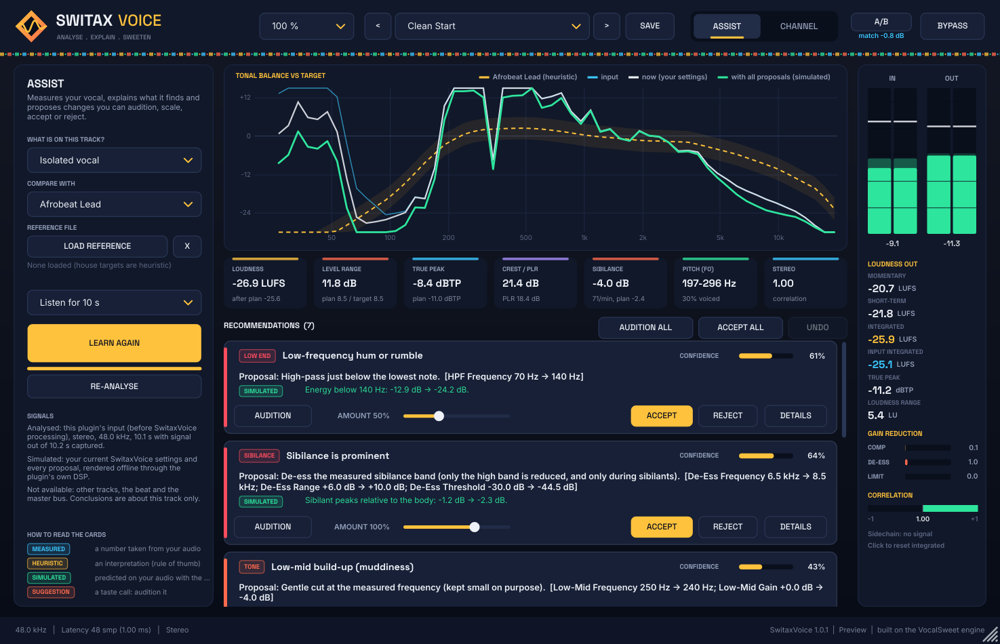

# SwitaxVoice: explainable vocal analysis + vocal channel strip (VST3)

SwitaxVoice listens to your vocal, **measures** it, explains what it finds, **simulates** fixes on
your own audio with its real DSP, and lets you **audition, scale, accept or reject** every change.
It is built on the VocalSweet engine (VocalSweet itself is untouched and keeps working).

* Format: **VST3** (Windows x64, Linux x64) + Standalone. Mono or stereo, optional stereo/mono
  **sidechain** ("Beat") input used for analysis only.
* Latency: 1 ms (look-ahead limiter), reported to the host. CPU about 4-5 % of one core
  (stereo 48 kHz, every module on; measured).
* Window opens **sized to fit your screen** (design size 1180 × 760, scalable 50 %-200 %). Resize by dragging the
  right edge, bottom edge or bottom-right grip, or with the Size menu; the size is saved in the project.



## What it does

**Assist page**
1. Tell it what is on the track (isolated vocal, vocal with bleed, vocal bus, full mix,
   instrumental) and what to compare with: a style house target (Afrobeat Lead, Afrofusion Lead,
   Amapiano Vocal, Melodic Rap, Afro-Pop Bright, Natural), or a **reference file** you load (WAV,
   AIFF, FLAC, OGG, MP3), which is measured with the same code.
2. Press **LEARN** and play 10-45 s (pauses are not counted).
3. In the background it measures loudness (BS.1770-4: M/S/I, LRA), true peak, crest/PLR, noise
   floor, clipping, the 1/6-octave tonal balance, resonance persistence, pitch range (YIN),
   sibilance events, stereo correlation/mono loss and, with a sidechain, vocal-vs-beat level and
   presence masking.
4. Rules turn deviations into **bounded** proposals (EQ cuts <= 4 dB, boosts <= 3 dB,
   compression <= about 6 dB average gain reduction, de-essing that may not dull the vowels by more than 2 dB).
   Every proposal is rendered through the real chain on your captured audio and re-measured.
5. Each card shows **MEASURED** evidence, the **HEURISTIC** interpretation, the **SUGGESTION**,
   the **SIMULATED** result, a confidence value with its basis, and limitations, plus
   **Audition**, **Amount 0-150 %**, **Accept**, **Reject**, Accept all, Audition all and Undo.
6. **A/B** plays the unprocessed input level-matched to the output (so louder doesn't win).

It never auto-applies anything, never maximises loudness, and says what it could **not** hear
(other tracks, the beat unless sidechained, the master bus).

**Channel page:** HPF (12/24 dB), 5-band tone EQ (low-mid, box, narrow harsh, presence, air
shelf), compressor (auto makeup), split-band de-esser, ADAA saturation, exciter, doubler, output
(input/output gain, dry/wet, ceiling + look-ahead limiter), live in/out spectrum and the EQ curve
computed from the DSP's own equations. The right rail shows peak/RMS meters, LUFS
(M/S/I, input I), true peak, LRA, gain reduction and correlation.

**Presets:** Clean Start, Afrobeat Lead, Afrofusion Lead, Amapiano Vocal, Melodic Rap,
Afro-Pop Bright, Background Stack, Ad-lib Spice, Analysis Only (host programs plus user
`.sxpreset` files in `%APPDATA%\SwitaxVoice\Presets`). Copies are in `presets/`.

## Build

Requirements: CMake 3.22+, C++17, JUCE 8.0.4 (downloaded if `SWITAX_JUCE_DIR` is unset) and the
**VocalSweet** folder next to this one (its `Source/dsp` primitives are shared).

```bat
:: Windows, Visual Studio 2022
cmake -B build -G "Visual Studio 17 2022" -A x64
cmake --build build --config Release
:: -> build\SwitaxVoice_artefacts\Release\VST3\SwitaxVoice.vst3
```
```bash
# Linux (also builds the tests)
cmake -B build -G Ninja -DCMAKE_BUILD_TYPE=Release
cmake --build build && ctest --test-dir build --output-on-failure
# Windows from Linux (how the shipped binary was made): see ../VocalSweet/README.md, then
cmake -B build-win -G Ninja -DCMAKE_BUILD_TYPE=Release \
  -DCMAKE_TOOLCHAIN_FILE=../VocalSweet/cmake/WindowsCrossClangCl.cmake -DXWIN_DIR=/opt/xwin-sdk
```

## Tests (results in `test-results/`)
* `tests/CoreTests.cpp` (50): EBU Tech 3341 cases 1-4, EBU Tech 3342 LRA cases, 22.05-192 kHz,
  K-weighting, true peak, spectrum calibration, YIN accuracy, activity, clipping, stereo,
  sibilance, chain (bit-exact bypass, block-size invariance, EQ curve = measured, NaN/extremes,
  CPU), advisor behaviour on injected faults (and no false positives), safety bounds, and
  **real recordings** (VocalSet, CC BY 4.0).
* `tests/PluginTests.cpp` (26): parameters, layouts incl. sidechain, processing, host bypass,
  audition/A-B/accept semantics, state round trip incl. Assist settings, presets, automation
  smoothness, live meters through the plugin, LEARN end-to-end with audio-thread timing, card
  accept/undo/reject, editor snapshots, preset export.
* pluginval 1.0.4 strictness 10 (Linux VST3; Windows VST3 under Wine, non-GUI).

## Docs
[INSTALL_WINDOWS](docs/INSTALL_WINDOWS.md) · [ARCHITECTURE](docs/ARCHITECTURE.md) ·
[RESEARCH](docs/RESEARCH.md) · [TEST_REPORT](docs/TEST_REPORT.md) ·
[KNOWN_LIMITATIONS](docs/KNOWN_LIMITATIONS.md) · [LICENSES](docs/LICENSES_AND_DEPENDENCIES.md)
