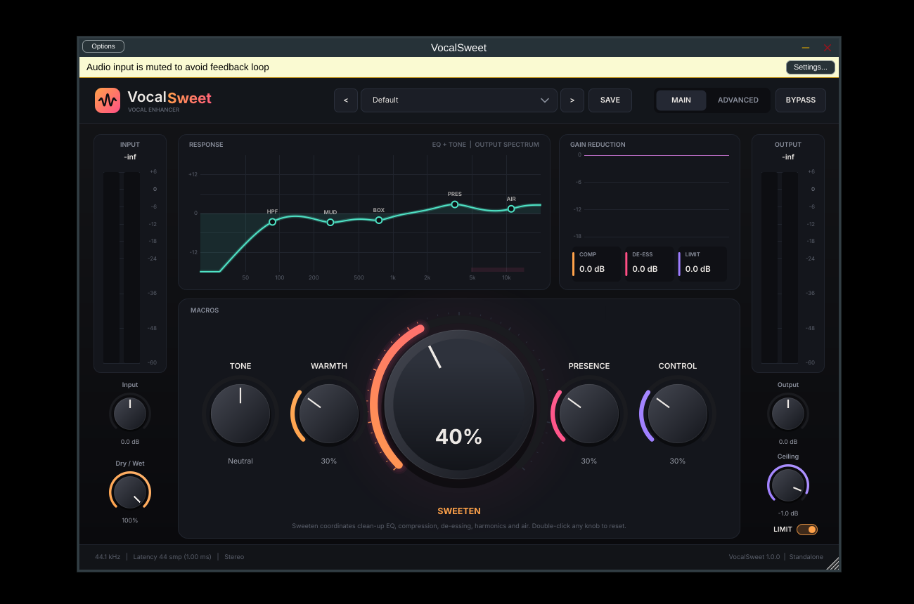

# VocalSweet — vocal enhancer plugin (VST3)

VocalSweet is a one-knob-first vocal processing plugin. Load it on a raw vocal, pick a preset,
turn **SWEETEN**, and fine-tune with **Tone / Warmth / Presence / Control**. Every macro drives a
real, fully adjustable processing chain that you can open on the **Advanced** page.

* Format: **VST3** (Windows x64; also built for Linux x64) plus a **Standalone** app
* Channels: mono → mono and stereo → stereo
* Sample rates: tested at 22.05 kHz to 192 kHz, block sizes 1 to 4096 (including randomly varying sizes)
* Latency: 1.0 ms (look-ahead limiter), reported to the host for automatic delay compensation
* CPU: about 2.6 % of one core for stereo 48 kHz with every module on (measured, see `test-results/`)



## Signal chain

```
in → Input gain → High-pass (12/24 dB/oct) → Mud & Box cuts + Tone/Warmth shelves
   → Compressor (soft knee, stereo-linked, auto + manual makeup)
   → Warm saturation (asymmetric tanh, anti-aliased, DC-blocked)
   → Presence bell + Air shelf → Exciter (upper-harmonic enhancer)
   → De-esser (split-band) → Doubler (2-voice ADT)
   → Dry/Wet → Output gain → Look-ahead peak limiter (ceiling) → Bypass crossfade → out
```

All filters are TPT state-variable filters, which stay stable while being modulated. Every
parameter is smoothed: gains with one-pole smoothing, filter coefficients at 16-sample sub-block
rate, and on/off switches with 20 ms linear crossfades. Bypass is latency-compensated,
click-free, and bit-exact once the crossfade finishes. NaN/Inf input is sanitised, and a
watchdog resets the DSP if its state ever becomes non-finite. The audio thread does no
allocation, locking or disk I/O.

## Controls

| Control | What it does |
|---|---|
| **SWEETEN** | Overall polish. Cuts mud and box, adds presence and air, slightly tightens the low end, adds glue compression and harmonics, and deepens de-essing so the extra brightness never turns harsh. |
| **Tone** | Dark ↔ bright tilt (200 Hz low shelf and 3 kHz high shelf moving in opposite directions). |
| **Warmth** | Low-mid body, even-harmonic (asymmetric) saturation, slightly softer top end. |
| **Presence** | 3–5 kHz forwardness, exciter, and matching extra de-essing. |
| **Control** | Levelling: lower threshold, higher ratio, extra de-essing. |
| Input / Output | ±24 dB trims. |
| Dry / Wet | Parallel blend with the unprocessed signal. |
| Ceiling + LIMIT | Output peak limiter (clip protection); ceiling from −12 to 0 dBFS. |
| BYPASS | Click-free, latency-compensated bypass (also mapped to the host's bypass). |
| Advanced page | HPF frequency/slope, Mud/Box/Presence/Air frequency and gain, compressor threshold/ratio/attack/release/makeup, de-esser frequency/threshold/range, saturation drive, exciter frequency/amount, doubler amount/width, plus an on/off switch per module. |

How the macros work: the Advanced controls are your base settings, and the macros add
coordinated offsets on top of them. With every macro at 0 (Tone centred) the processing equals
the Advanced settings exactly; this is checked by a test. The EQ curve on screen is computed from
the same effective values the DSP uses, and a test verifies it matches the measured response
within 0.25 dB. Compressor makeup includes an automatic part (80 % of the gain reduction at a
typical −14 dBFS vocal peak), so moving macros stays close to loudness-neutral. The **Makeup**
knob adds to that.

*VocalSweet does not analyse or "understand" the singer. Presets are static starting points
and the macros are fixed musical mappings.*

## Presets

Default · **Afrobeat Lead** · **Afrofusion Lead** · **Warm Intimate Vocal** · **Bright Pop Vocal**
· **Melodic Rap** · **Smooth Background Vocal** · **Vocal Double** · **Natural Clean Vocal**

Each one is a complete set of parameter values (see `Source/dsp/Presets.h`). They are exposed
as host programs, so FL Studio's preset arrows work too. **SAVE** writes your current settings
as a user preset (`*.vspreset` XML) to:

* Windows: `%APPDATA%\VocalSweet\Presets\`
* Linux: `~/.config/VocalSweet/Presets/`

The full plugin state, including the current preset name, is saved inside your DAW project.

## Installing on Windows (FL Studio / Audacity)

See **[docs/INSTALL_WINDOWS.md](docs/INSTALL_WINDOWS.md)**. Short version: copy the
`VocalSweet.vst3` **folder** to `C:\Program Files\Common Files\VST3\`, then rescan plugins.

## Building from source

Requirements: CMake 3.22+, a C++17 compiler and JUCE 8.0.4 (downloaded automatically if
`VOCALSWEET_JUCE_DIR` is not set).

**Windows (native, Visual Studio 2022):**
```bat
cmake -B build -G "Visual Studio 17 2022" -A x64
cmake --build build --config Release
:: -> build\VocalSweet_artefacts\Release\VST3\VocalSweet.vst3
```

**Linux (native, also builds the tests):**
```bash
sudo apt install libasound2-dev libfreetype-dev libfontconfig1-dev libx11-dev libxrandr-dev \
     libxinerama-dev libxcursor-dev libgl1-mesa-dev
cmake -B build-linux -G Ninja -DCMAKE_BUILD_TYPE=Release
cmake --build build-linux
ctest --test-dir build-linux --output-on-failure
```

**Windows from Linux (how the shipped binary was made):** clang-cl 20, lld-link and the MSVC
CRT/Windows SDK fetched with [`xwin`](https://github.com/Jake-Shadle/xwin):
```bash
xwin --accept-license --arch x86_64 splat --output /opt/xwin-sdk
python3 cmake/xwin_case_fix.py /opt/xwin-sdk <JUCE>/modules Source   # case-insensitive header/lib names
cmake -B build-win -G Ninja -DCMAKE_BUILD_TYPE=Release \
      -DCMAKE_TOOLCHAIN_FILE=cmake/WindowsCrossClangCl.cmake -DXWIN_DIR=/opt/xwin-sdk
cmake --build build-win
```
JUCE does not officially support this cross-compile route. It works here because the output is
an ordinary MSVC-ABI DLL with a statically linked CRT, and it was validated with pluginval under
Wine (see limitations).

## Tests

* `tests/DspTests.cpp`: 40 framework-independent DSP checks (silence, −100 dBFS, sine, impulse,
  white/pink noise, mono/stereo, 7 sample rates × 9 block sizes, block-size invariance, latency,
  HPF/EQ response vs display, compressor GR and attack, saturation harmonics/aliasing/DC,
  de-esser selectivity, parameter extremes plus 150 random combinations, dry/wet linearity,
  bit-exact bypass, click-free switching, NaN/Inf injection, +12 dBFS clipping, preset
  distinctness, Sweeten behaviour, CPU).
* `tests/PluginTests.cpp`: 16 checks on the real JUCE processor and editor (parameters, value
  text, bus layouts, host bypass, varying host blocks, state save/restore, corrupt state,
  factory programs, user preset files, automation smoothing, editor rendering to PNG).
* `tests/RenderPresets.cpp`: renders test WAVs (synthetic vocal, log sweep, pink noise) through
  every preset.
* pluginval 1.0.4 at strictness 10: Linux VST3 (all tests), and the Windows VST3 under Wine
  (non-GUI tests).

Results are in `test-results/`. The acceptance summary is in
[docs/ACCEPTANCE_REPORT.md](docs/ACCEPTANCE_REPORT.md).

## Project layout

```
Source/dsp/        framework-independent DSP: Svf.h, Dynamics.h, Tone.h, VocalChain.h,
                   Params.h (parameter table + macro mapping), Presets.h
Source/            PluginProcessor, PluginEditor, PresetManager (JUCE)
Source/ui/         LookAndFeel, Widgets (knobs, meters, EQ/analyzer, GR history, module panels)
tests/             DSP tests, plugin tests, WAV renderer
cmake/             Windows cross toolchain + xwin case-fix helper
Resources/fonts/   Inter (SIL OFL 1.1)
docs/              install guide, licensing, known limitations, acceptance report
```

## Licensing

See [docs/LICENSES_AND_DEPENDENCIES.md](docs/LICENSES_AND_DEPENDENCIES.md). Personal use is
fine. Distributing the plugin requires appropriate JUCE and VST3 licensing (or an
AGPLv3/GPLv3 source release).
